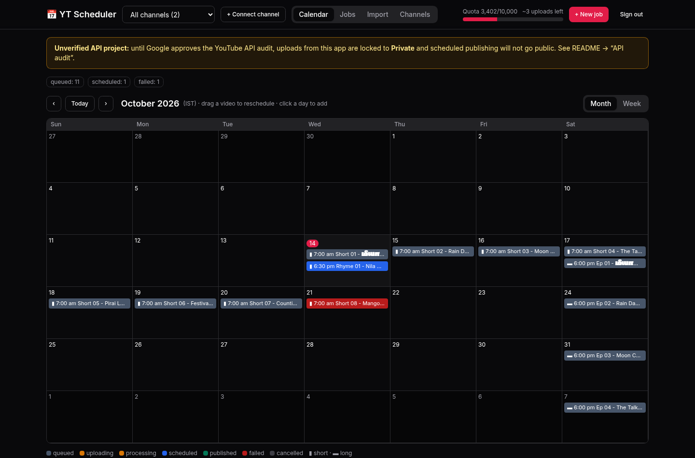
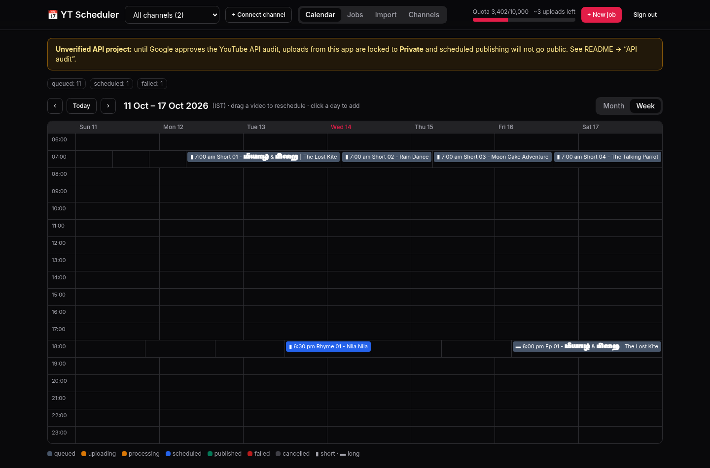
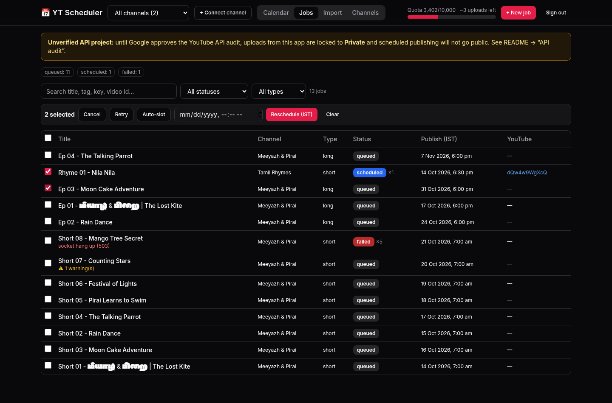
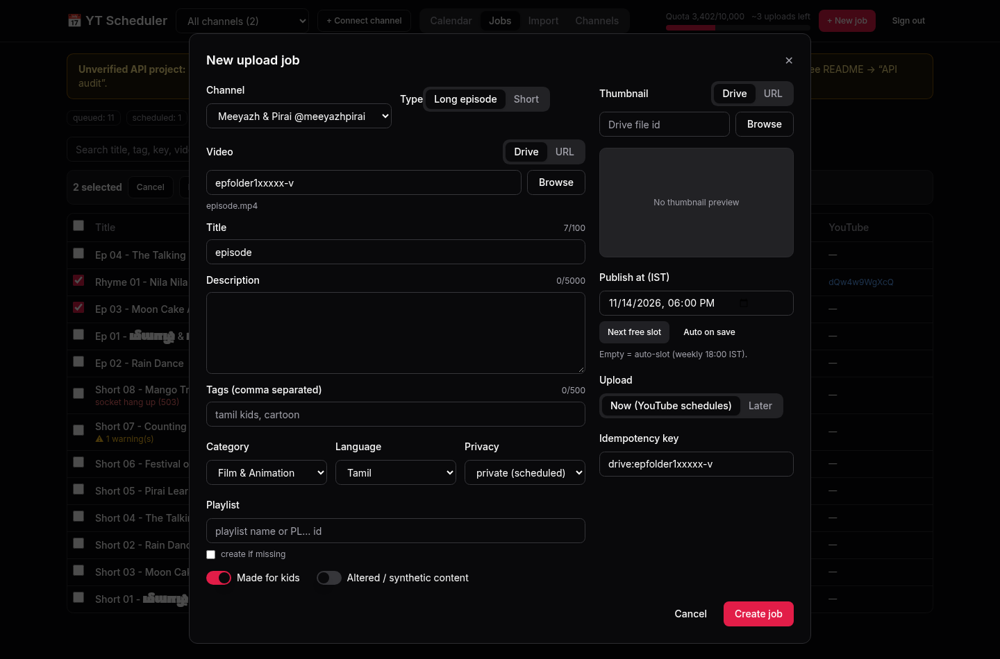
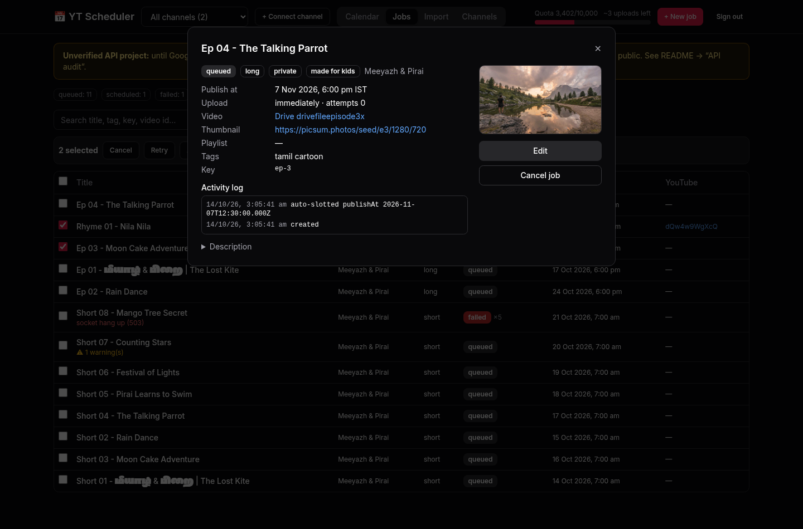
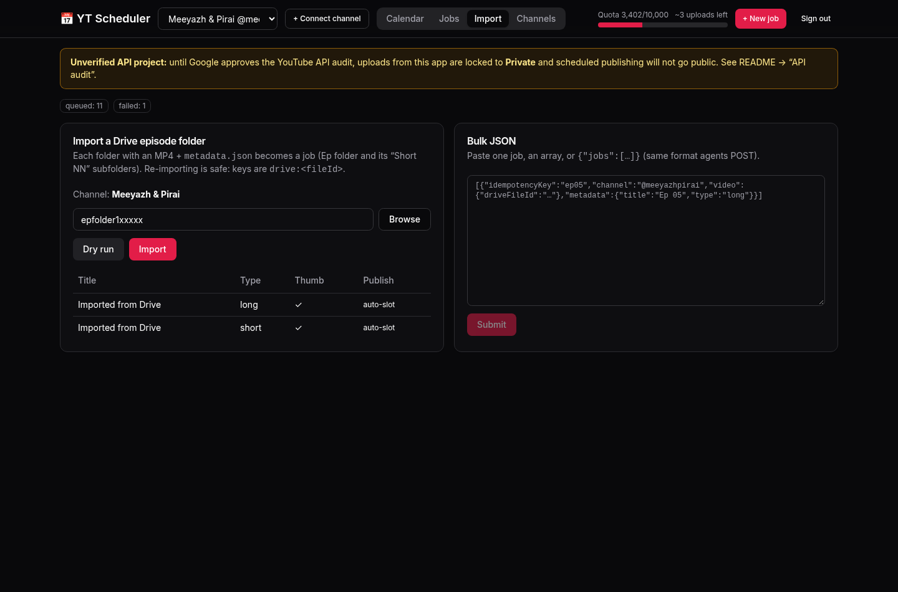
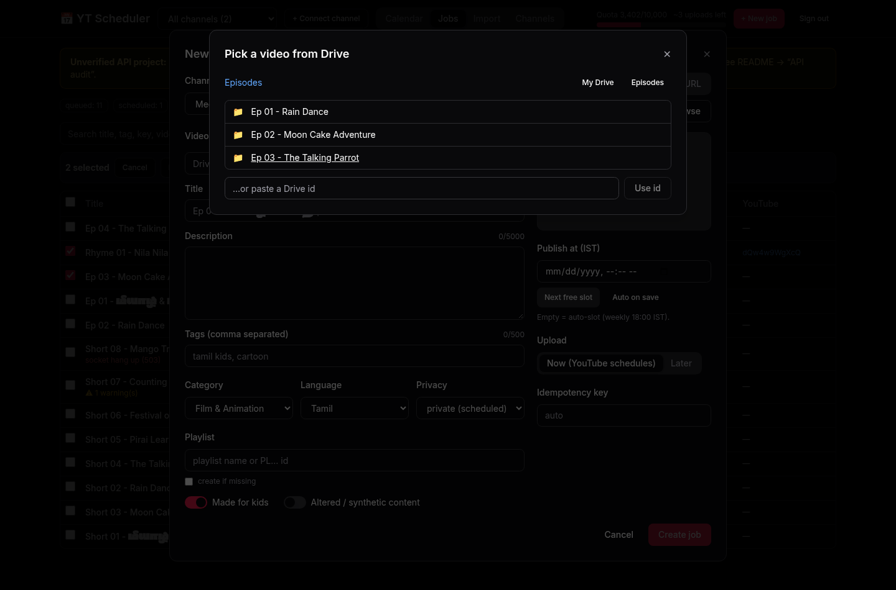
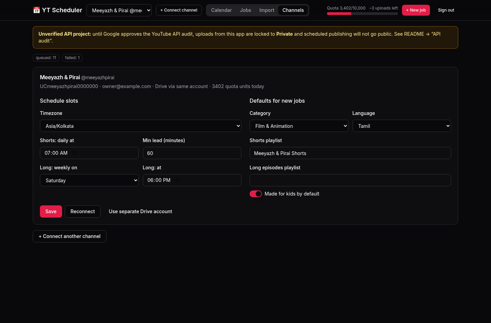

# YT Scheduler (`@apps/yt-scheduler`)

This is a self-hosted, free-to-run YouTube upload scheduler. It's built for agent pipelines like the YouTube Ideas agent for **@meeyazhpirai**, and it supports more than one channel. You push a job with the video (Drive file id or https URL), thumbnail and metadata. The app streams the video into YouTube with a resumable upload, sets the thumbnail, adds it to a playlist, and uses YouTube's native scheduling (`private` + `publishAt`). If you leave `publishAt` out, it picks the next free slot for you.

> ⚠️ **Private-locked until audited.** If a Google Cloud project hasn't passed the YouTube API compliance audit, every video it uploads through `videos.insert` is locked to **Private**, and scheduled publishing won't make it public. The UI shows a banner about this. See [API audit](#api-audit).

## Web app
The service ships a React + Vite + Tailwind single-page app. It uses the shadcn-style primitives in `@repo/ui/shadcn`. The Hono server serves the static build from `dist/web`, so the whole thing stays **one deployable service**.

| | |
|---|---|
|  |  |
|  |  |
|  |  |
|  |  |

- **Sign-in gate:** the API key is checked against the server and kept in `localStorage`.
- **Header:** channel switcher (all channels or one), **+ Connect channel** (OAuth), and a quota meter with uploads left today.
- **Calendar (month/week, in the channel's timezone, IST by default):**
  - Drag a video to another day (keeps its time) or to another hour (week view) to reschedule it.
  - Videos already on YouTube are moved with `videos.update`.
  - Click an empty day or hour to create a job at that time.
- **Jobs:** search, status and type filters, plus bulk **cancel / retry / auto-slot / reschedule**.
- **Create/Edit form:**
  - Choose Drive or URL for the video and thumbnail. The **Drive picker** browses folders and starts at the Episodes folder.
  - Thumbnail preview (16:9 or 9:16).
  - Title with a 100-char counter, description, tags with a 500-char counter, category, language, privacy.
  - Playlist picker filled from the channel's playlists.
  - Made-for-kids and synthetic-media switches, short/long, and publish time in IST with a **Next free slot** button.
  - Upload now or later.
- **Job detail:** activity log, last error, warnings, Drive/URL links, YouTube Studio and youtu.be links, plus edit/reschedule, cancel and retry.
- **Import:** Drive folder import with a **dry-run preview**, and a bulk JSON paste box.
- **Channels:** schedule slot editor (timezone, Shorts daily time, long-episode weekday and time, minimum lead) and defaults (category, language, Shorts and long playlists, made-for-kids). Also reconnect, and pick a separate Drive account.

**Development:**
- Run `pnpm --filter @apps/yt-scheduler dev` (API on :8787) and `pnpm --filter @apps/yt-scheduler dev:web` (Vite on :5173, proxying `/api` and `/oauth`).
- **Offline demo with mock data, no Google needed:** `pnpm --filter @apps/yt-scheduler build && pnpm --filter @apps/yt-scheduler demo`, then open http://localhost:8788 with API key `demo`.

## Market reference (what we copied as ideas, not code)
| Tool | Takeaways |
|---|---|
| Buffer / Hootsuite / Later | Queue with fixed time slots ("posting schedule"), calendar and list views, retry when a publish fails. All paid for YouTube. |
| Metricool | Best-time slots, plus Shorts and long videos as separate content types. |
| **Postiz** (AGPL-3.0, OSS) | Public REST API for programmatic scheduling, OAuth per channel, made-for-kids and privacy fields. *AGPL, so we didn't use any of its code.* |
| Mixpost (MIT Lite) | The Lite edition has no YouTube; YouTube is in the paid Pro tier. Self-host model, workspaces with several accounts. |
| TubeBuddy / vidIQ | Metadata templates and defaults, bulk metadata, upload-time hints. |
| n8n YouTube node | Upload and playlist actions as building blocks, but you have to wire scheduling and retries yourself. |

What ended up here: per-channel slot queues, idempotent API jobs, bulk import, Drive folder import, quota meter, private-locked banner, and retries with backoff.

## Quick start (local)
```bash
cp apps/yt-scheduler/.env.example apps/yt-scheduler/.env   # fill it (see below)
docker compose -f apps/yt-scheduler/docker-compose.yml up -d --build
open http://localhost:8787            # paste API_KEY, then "Connect channel"
```
Development without Docker: `pnpm install`, have a Postgres running, then `pnpm --filter @apps/yt-scheduler dev`.

Tests, lint and build: `pnpm turbo run test lint build --filter=@apps/yt-scheduler`.

## Google Cloud setup (one time, ~10 min)
1. Go to https://console.cloud.google.com and create a project, e.g. `yt-scheduler`.
2. Under **APIs & Services → Library**, enable **YouTube Data API v3** and **Google Drive API**.
3. Set up the **OAuth consent screen** (Google Auth Platform):
   - User type **External**. App name, support email.
   - Scopes: `youtube.upload`, `youtube`, `drive.readonly`, `openid`, `email`.
   - **Test users:** add the Google account that owns @meeyazhpirai, and any account that owns the Drive folder.
   - ⚠️ While the app is in **Testing**, refresh tokens **expire after 7 days**. For ongoing use, click **Publish app** (to "In production"). You don't need verification for your own accounts. You'll just click through an "unverified app" warning once, and you can do that for up to 100 users.
4. Under **Credentials → Create credentials → OAuth client ID → Web application**, add the authorized redirect URI `https://<your-host>/oauth/callback` (and `http://localhost:8787/oauth/callback` for local). Copy the client id and secret into `.env`.
5. Generate the secrets: `openssl rand -base64 32` for `ENCRYPTION_KEY`, and a long random `API_KEY`.
6. Open the UI, click **Connect channel**, and pick the **brand account / channel** on Google's screen. Repeat this for every channel you add.
   - If the Drive files live under a different Google account, click "use separate Drive account" on the channel.
7. In YouTube Studio, make sure the channel is **phone-verified**. Custom thumbnails need this.

### API audit
To lift the private-lock, and to get more than the default 10,000 units/day, fill in the **YouTube API Services Audit and Quota Extension Form**: https://support.google.com/youtube/contact/yt_api_form
- Describe it as an internal tool that uploads the owner's own channel content.
- Link a privacy policy and terms page. A simple page on your portfolio is enough.
- Expect a screencast request and a few weeks of turnaround.

When it's approved, set `YOUTUBE_API_AUDITED=true` to hide the banner. Until then, you can upload as private and then switch the video to public or scheduled by hand in Studio.

Quota costs: `videos.insert` 1600, `thumbnails.set` 50, `playlistItems.insert` 50, `playlists.list` 1. That's about 1,701 per job, or roughly **5 uploads a day** on the default quota. The quota is shared by **all channels** in one project, and it resets at midnight Pacific time. Jobs that would exceed it are deferred automatically.

## Deploy (free)
**Recommended: Render free web service + Neon free Postgres**
1. Create a Neon project at https://neon.tech and copy its connection string (`…?sslmode=require`).
2. In Render, choose **New → Blueprint** and point it at this repo. It picks up `apps/yt-scheduler/render.yaml`. Fill in the env vars, and set `APP_URL` and `GOOGLE_REDIRECT_URI` to `https://<service>.onrender.com/oauth/callback`.
3. Free Render instances sleep after 15 minutes idle, so the internal tick stops. Create a free cron at https://cron-job.org that runs every 5 minutes:
   `POST https://<service>.onrender.com/api/tick` with the header `x-api-key: <API_KEY>`. This wakes the app and processes due jobs.
   Uploads are only ~100 MB, so they finish well inside a request.

**Alternative: always-on VM** (Oracle Cloud Always-Free, or any small VPS). Clone the repo, fill in `.env`, and run `docker compose -f apps/yt-scheduler/docker-compose.yml up -d --build`. Put Caddy in front for HTTPS.

## Sidecar `metadata.json`
The schema is in [`schema/metadata.schema.json`](schema/metadata.schema.json), and the full job schema is in [`schema/job.schema.json`](schema/job.schema.json). Regenerate both with `pnpm --filter @apps/yt-scheduler gen:schema`.

| field | default | notes |
|---|---|---|
| `title` | required | ≤100 chars, Tamil + English OK |
| `description` | `""` | ≤5000. Shorts get `#Shorts` appended if it's missing |
| `tags` | `[]` | ≤500 chars total |
| `categoryId` | channel default `"1"` | 1 = Film & Animation, 27 = Education |
| `defaultLanguage` / `defaultAudioLanguage` | `ta` | |
| `madeForKids` | `true` | |
| `containsSyntheticMedia` | `false` | YouTube altered/synthetic content disclosure |
| `type` | `long` | `short` or `long`. Drive import infers `short` from `Short NN` folders |
| `privacyStatus` | `private` | must be `private` for scheduled publishing |
| `publishAt` | auto-slot | ISO with offset, e.g. `2026-10-20T07:00:00+05:30` |
| `playlist` | channel default | playlist id `PL…` or exact name, e.g. `Meeyazh & Pirai Shorts` |
| `createPlaylistIfMissing` | `false` | creates a public playlist with that name |
| `channel` | — | `UC…` id or `@handle`. Needed here or on the job |

Example:
```json
{
  "channel": "@meeyazhpirai",
  "title": "Short 03 - மீயாழ் & பிறை | Rain Dance",
  "description": "Meeyazh and Pirai dance in the rain! #tamilkids",
  "tags": ["tamil kids", "cartoon", "meeyazh pirai"],
  "categoryId": "1",
  "type": "short",
  "playlist": "Meeyazh & Pirai Shorts",
  "madeForKids": true
}
```

## Pushing jobs (for the YouTube Ideas agent)
```bash
curl -X POST "$APP_URL/api/jobs" -H "x-api-key: $API_KEY" -H "content-type: application/json" -d '{
  "idempotencyKey": "ep03-short03",
  "channel": "@meeyazhpirai",
  "video":     { "driveFileId": "1AbC...mp4id" },
  "thumbnail": { "driveFileId": "1XyZ...jpgid" },
  "metadata": { "title": "Short 03 - Rain Dance", "type": "short", "playlist": "Meeyazh & Pirai Shorts" }
}'
```
- **Bulk:** `{"jobs":[ …up to 200… ]}` returns `207` with one result per item. Sending the same `idempotencyKey` again returns the existing job.
- **Whole episode folder:** `curl -X POST $APP_URL/api/drive/import -H "x-api-key: $API_KEY" -H 'content-type: application/json' -d '{"folderId":"<Ep NN folder id>","channel":"@meeyazhpirai","dryRun":true}'`. Set `dryRun:false` to create the jobs. Each folder with an MP4 and a `metadata.json` becomes a job, the first jpg/png becomes the thumbnail, and the idempotency key is `drive:<videoFileId>`.
- **Defer the upload itself:** `"uploadMode":"at","uploadAt":"…"`. By default it uploads right away and lets YouTube publish at `publishAt`.
- **Other endpoints:** `GET /api/slots/next?channel=@meeyazhpirai&type=short`, `GET /api/quota`, `GET /api/jobs?channel=…&status=failed`.

## Management API (used by the web app)
| Endpoint | Purpose |
|---|---|
| `PATCH /api/jobs/:id` | edit a queued, failed or cancelled job (fully re-validated). After upload, only `metadata.publishAt` can change |
| `POST /api/jobs/:id/reschedule {publishAt}` | move the publish time. If the video is already uploaded and scheduled, it calls YouTube `videos.update` (50 units) |
| `POST /api/jobs/bulk {ids, action, publishAt?}` | `action` is `cancel`, `retry`, `reschedule` or `autoslot` |
| `GET /api/drive/list?channel=&folderId=` | Drive browser (`root` by default) |
| `GET /api/drive/file/:id?channel=` | image preview proxy |
| `GET /api/channels/:id/playlists` | playlists for the picker |
| `GET /api/config` | public flags (audited, quota limit) |

Each job also keeps a `log` of `{at, msg}` entries: created, auto-slotted, attempts, upload id, thumbnail, playlist, reschedules.

## Per-channel defaults and slots
`PATCH /api/channels/:id` with a body like:
`{"defaults":{"shortsPlaylist":"Meeyazh & Pirai Shorts","categoryId":"1"},"slots":{"shortsTime":"07:00","longWeekday":6,"longTime":"18:00","timezone":"Asia/Kolkata"}}`

## Limitations
- Private-lock and scheduling need the API audit (see above). The default quota is about 5 uploads a day, shared across channels.
- Single operator API key; there are no per-user logins.
- The Postgres store's SQL is covered by review but not by CI. The tests run against the in-memory store.
- You can't cancel a job after upload from here. Use YouTube Studio for that.
- If a mid-upload crash happens after YouTube accepted the bytes but before we saved the id, a retry could create a duplicate private video.
- Drag-to-reschedule can't move published, uploading or cancelled videos. Moving a video that's already uploaded only changes its publish time on YouTube, not its title or description.
- Drive thumbnail previews are proxied through the server with the API key. The Drive picker only lists what the connected Google account can see.
