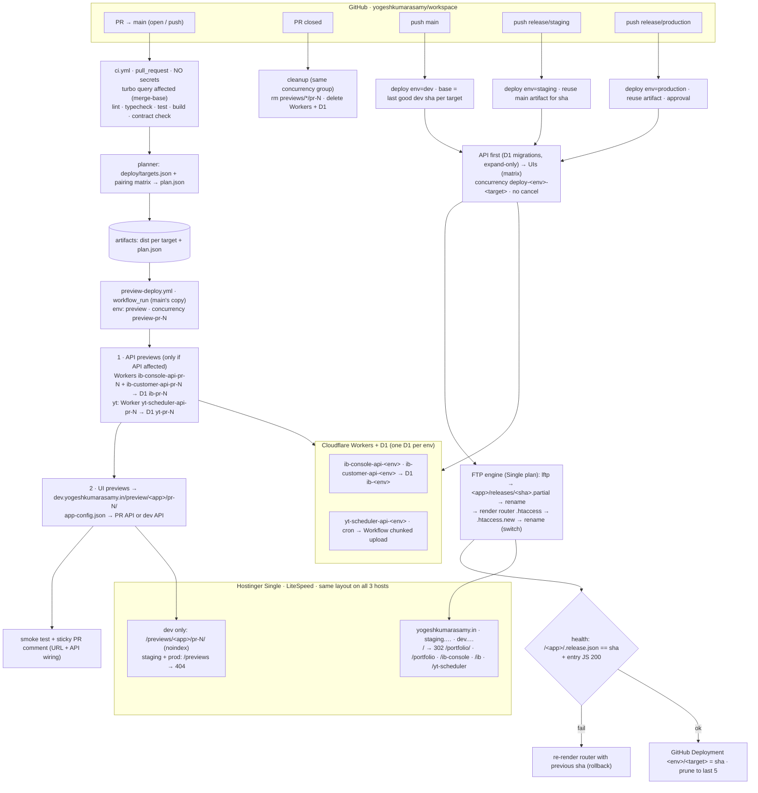

# CI/CD Revamp Plan: `yogeshkumarasamy/workspace` (v2)

> **Authority**: Absolute  
> **Status**: Living Architectural Specification & Tracking Plan  
> **Tracking Issue**: [#93](https://github.com/yogeshkumarasamy/workspace/issues/93)  
> **Constitutional Reference**: [Repository Constitution](file:///.specify/memory/constitution.md) & [Monorepo Architecture Memory](file:///.specify/memory/monorepo.md)  
> **Revised**: 2026-10-18 (IST)

---

## 1. Decisions Recorded

| Topic | Decision |
|---|---|
| Hosts | `dev.yogeshkumarasamy.in`, `staging.yogeshkumarasamy.in`, `yogeshkumarasamy.in`. **No `preview.*` host.** |
| Paths | The same on all three hosts: `/<app>/`; previews at `/previews/<app>/pr-<N>/` (served under `/preview/` dev root) |
| App slugs | `portfolio`, `ib-console` (Innings Break console), `ib` (Innings Break customer), `yt-scheduler` |
| Previews | Only for PRs whose base is `main` (stacked PRs out of scope), only on **dev**; public with `noindex`, no password. None on staging/prod. |
| Environments | dev (`main`), staging (`release/staging`), production (`release/production`) |
| Hostinger | **Single Web Hosting: FTP only, no SSH.** Deploy with FTP release folders and an `.htaccess` switch. SSH/rsync/symlinks become a future upgrade (Premium+). |
| Portfolio | Moves from root to `/portfolio/`; `/` redirects to `/portfolio/` |
| Innings Break APIs | Two Workers (console API, customer API) sharing **one D1 per env**; a per-PR preview D1 when an API changes |
| yt-scheduler API | **Option A (Cloudflare Workers + D1)** locked in following Y0 spike confirmation. |
| Monorepo tool | Turborepo stays |
| `release/staging` | Reset to `main` as part of ticket T04. From then on, `release/*` branches are only fast-forwarded to tested shas. |
| YouTube outside prod | **Mocked everywhere except production** (`YOUTUBE_MODE=mock` on dev, staging, and previews). No separate Google Cloud project; only prod registers a real OAuth redirect and uses the real quota. |
| Stacked PR previews | **Out of scope.** Previews run only for PRs whose base is `main`; PRs targeting other branches get CI checks but no preview. |

---

## 2. Current Problems & Solutions

| # | Problem | Impact | Solution |
|---|---|---|---|
| P1 | Workflows hard-coded `@apps/portfolio`. No affected detection, no app matrix; `turbo.json` had no `test` task. | New apps could not deploy; every PR rebuilt portfolio. | Turborepo affected pipeline ([T05](https://github.com/yogeshkumarasamy/workspace/issues/68), [T06](https://github.com/yogeshkumarasamy/workspace/issues/69)) + targets/planner ([T07](https://github.com/yogeshkumarasamy/workspace/issues/70)). |
| P2 | No `concurrency` anywhere. Overlapping runs collided. | Older commit could overwrite newer build; files mixed. | Concurrency groups on workflows and per-target matrix ([T01](https://github.com/yogeshkumarasamy/workspace/issues/63)). |
| P3 | `FTP-Deploy-Action` uploaded file-by-file into live folder and trusted `.ftp-deploy-sync-state.json`. | Non-atomic. Open tabs 404ed on deleted chunks. | Reusable FTP release engine uploading to `releases/<sha>.partial/`, renaming, and switching `.htaccess` ([T09](https://github.com/yogeshkumarasamy/workspace/issues/73)). |
| P4 | Preview slug collided (`feat/a` = `feat_a`) and was shell-interpolated. | Path traversal or preview collisions. | Canonical `pr-<N>` folders with strict numeric validation ([T02](https://github.com/yogeshkumarasamy/workspace/issues/64)). |
| P5 | `cleanup-preview.yml` failed every run. | Previews leaked permanently on Hostinger. | Robust lftp cleanup script restricted to `pr-<N>` ([T03](https://github.com/yogeshkumarasamy/workspace/issues/65)). |
| P6 | `release/staging` built `@apps/web` (stale tip). Prod was a fresh rebuild. | Staging broken; prod not verified from tested artifact. | Reset staging to `main` ([T04](https://github.com/yogeshkumarasamy/workspace/issues/66)) and artifact reuse promotion ([T12](https://github.com/yogeshkumarasamy/workspace/issues/76), [T21](https://github.com/yogeshkumarasamy/workspace/issues/91)). |
| P7 | PR workflows ran with FTP secrets on single-account hosting. | Any PR branch could wipe production. | Split PR build (`ci.yml` - zero secrets) from deploy (`preview-deploy.yml` via `workflow_run` with `preview` environment). |
| P8 | No health checks, no rollback, no timeouts. | Silent breakage on deploy. | Smoke test + automatic rollback + `rollback.yml` ([T11](https://github.com/yogeshkumarasamy/workspace/issues/75)). |
| P9 | Node server process required for yt-scheduler, but Hostinger Single has no Node.js runtime. | Could not host fullstack Node apps on Hostinger. | Architecture split: static UI on Hostinger + Workers API on Cloudflare ([Y1](https://github.com/yogeshkumarasamy/workspace/issues/89), [YA1](https://github.com/yogeshkumarasamy/workspace/issues/121)). |
| P10 | Nothing declared "this UI talks to that API". | Previews could not wire APIs correctly. | [deploy/targets.json](file:///deploy/targets.json) manifest + [deploy/plan.mjs](file:///deploy/plan.mjs) UI-API pairing. |

---

## 3. Target Architecture

### 3.1 Registered Targets

Defined in [deploy/targets.json](file:///deploy/targets.json):

| Target | Package | Kind | Where | Talks to |
|---|---|---|---|---|
| `portfolio` | `@apps/portfolio` | static, hash router | Hostinger `/portfolio/` | – |
| `ib-console` | `@apps/innings-break-console` | static SPA/PWA, history routing | Hostinger `/ib-console/` | `ib-console-api` |
| `ib` | `@apps/innings-break` | static SPA/PWA, history routing | Hostinger `/ib/` | `ib-customer-api` |
| `yt-scheduler` | `@apps/yt-scheduler` | static SPA/PWA, history routing | Hostinger `/yt-scheduler/` | `yt-scheduler-api` |
| `ib-console-api` | `@apps/innings-break-console-api` | Cloudflare Worker (Hono) | `ib-console-api-<env>` | D1 `ib-<env>` |
| `ib-customer-api` | `@apps/innings-break-customer-api` | Cloudflare Worker (Hono) | `ib-customer-api-<env>` | D1 `ib-<env>` (shared DB) |
| `yt-scheduler-api` | `@apps/yt-scheduler-api` | Cloudflare Worker (Hono) | `yt-scheduler-api-<env>` | D1 `yt-<env>` |

---

## 4. Environments & URL Scheme

| Env | Git Trigger | Host | `/` | Portfolio | IB Console | IB Customer | YT Scheduler | Previews | APIs (`<acct>` = workers.dev) |
|---|---|---|---|---|---|---|---|---|---|
| **preview** | PR → `main` | `dev.yogeshkumarasamy.in` | – | `/preview/portfolio/pr-<N>/` | `/preview/ib-console/pr-<N>/` | `/preview/ib/pr-<N>/` | `/preview/yt-scheduler/pr-<N>/` | Hosted on dev | `ib-console-api-pr-<N>`, `ib-customer-api-pr-<N>`, `yt-scheduler-api-pr-<N>` |
| **dev** | push `main` | `dev.yogeshkumarasamy.in` | 302 → `/portfolio/` | `/portfolio/` | `/ib-console/` | `/ib/` | `/yt-scheduler/` | Yes | `*-dev.<acct>.workers.dev` |
| **staging** | push `release/staging` | `staging.yogeshkumarasamy.in` | 302 → `/portfolio/` | `/portfolio/` | `/ib-console/` | `/ib/` | `/yt-scheduler/` | 404 | `*-staging.<acct>.workers.dev` |
| **production** | push `release/production` | `yogeshkumarasamy.in` | 302 → `/portfolio/` | `/portfolio/` | `/ib-console/` | `/ib/` | `/yt-scheduler/` | 404 | `*-prod.<acct>.workers.dev` (or unsuffixed) |

---

## 5. UI ↔ API Pairing & Matrix

Implemented in [deploy/plan.mjs](file:///deploy/plan.mjs):

| # | UI Changed | API Changed | Contract / Migrations | UI Preview | API Preview | UI `apiBaseUrl` |
|---|---|---|---|---|---|---|
| 1 | Yes | – | – | Build + deploy | None | Latest **dev** API |
| 2 | – | Yes (code only) | – | Auto-rebuild (`paired-api`) | Deploy | **PR** preview API |
| 3 | – | Yes | Yes | Auto-rebuild | Deploy + fresh preview DB | **PR** preview API, contract check |
| 4 | Yes | Yes | Any | Build (`affected`) | Deploy | **PR** preview API |
| 5 | Contract package only | (Both via graph) | Yes | Build + deploy | Deploy | **PR** preview API, contract check |
| 6 | Shared library (`@repo/ui`) | – | – | Every dependent UI | None | Dev API |
| 7 | Docs / specs only | – | – | None | None | – (`ci-gate` passes) |

---

## 6. Epics & Ticket Index

### Epic E0: Stabilise Current CI/CD ([#62](https://github.com/yogeshkumarasamy/workspace/issues/62)) - Complete
- [x] **T01** ([#63](https://github.com/yogeshkumarasamy/workspace/issues/63)): Add concurrency groups, timeouts, and Node 20. (Merged in [#95](https://github.com/yogeshkumarasamy/workspace/pull/95))
- [x] **T02** ([#64](https://github.com/yogeshkumarasamy/workspace/issues/64)): Collision-free, injection-safe preview folder `pr-<N>`. (Merged in [#94](https://github.com/yogeshkumarasamy/workspace/pull/94))
- [x] **T03** ([#65](https://github.com/yogeshkumarasamy/workspace/issues/65)): Fix preview cleanup and purge legacy previews. (Merged in [#101](https://github.com/yogeshkumarasamy/workspace/pull/101))
- [x] **T04** ([#66](https://github.com/yogeshkumarasamy/workspace/issues/66)): Retire stale staging workflow and reset `release/staging` to `main`. (Merged in [#96](https://github.com/yogeshkumarasamy/workspace/pull/96))

### Epic E1: Affected-Only CI ([#67](https://github.com/yogeshkumarasamy/workspace/issues/67)) - Complete
- [x] **T05** ([#68](https://github.com/yogeshkumarasamy/workspace/issues/68)): Turbo tasks (`typecheck`, `test`, `lint`) and fix failing `tsc` in tests. (Merged in [#97](https://github.com/yogeshkumarasamy/workspace/pull/97))
- [x] **T06** ([#69](https://github.com/yogeshkumarasamy/workspace/issues/69)): `ci.yml` on `pull_request` (no secrets, `--affected`) with required `ci-gate`. (Merged in [#98](https://github.com/yogeshkumarasamy/workspace/pull/98), [#107](https://github.com/yogeshkumarasamy/workspace/pull/107))
- [x] **T07** ([#70](https://github.com/yogeshkumarasamy/workspace/issues/70)): `deploy/targets.json` and planner with UI-API pairing matrix. (Merged in [#100](https://github.com/yogeshkumarasamy/workspace/pull/100))

### Epic E2: FTP Release Engine on Hostinger ([#71](https://github.com/yogeshkumarasamy/workspace/issues/71))
- [ ] **T08** ([#72](https://github.com/yogeshkumarasamy/workspace/issues/72)): Hostinger setup: subdomains, GitHub Environments, and server probes.
- [x] **T09** ([#73](https://github.com/yogeshkumarasamy/workspace/issues/73)): Reusable `deploy-static.yml`: release folders, router switch, stale guard. (Merged in [#106](https://github.com/yogeshkumarasamy/workspace/pull/106))
- [x] **T10** ([#74](https://github.com/yogeshkumarasamy/workspace/issues/74)): `.htaccess` templates (root, router, release, previews) and `robots.txt`. (Merged in [#102](https://github.com/yogeshkumarasamy/workspace/pull/102))
- [ ] **T11** ([#75](https://github.com/yogeshkumarasamy/workspace/issues/75)): Smoke test, automatic rollback, and `rollback.yml`.
- [ ] **T12** ([#76](https://github.com/yogeshkumarasamy/workspace/issues/76)): `deploy.yml` for dev, staging, and production with artifact reuse.
- [ ] **T13** ([#77](https://github.com/yogeshkumarasamy/workspace/issues/77)): Move portfolio to `/portfolio/` with root redirect.

### Epic E3: PR Previews on Dev with UI-API Pairing ([#78](https://github.com/yogeshkumarasamy/workspace/issues/78))
- [ ] **T14** ([#79](https://github.com/yogeshkumarasamy/workspace/issues/79)): Split preview build (`ci.yml`) from deploy (`workflow_run`) to `/preview/<app>/pr-<N>`.
- [ ] **T15** ([#80](https://github.com/yogeshkumarasamy/workspace/issues/80)): `app-config.json` runtime config and PR wiring comment.
- [ ] **T16** ([#81](https://github.com/yogeshkumarasamy/workspace/issues/81)): Preview teardown on close and nightly sweep.

### Epic E4: Innings Break APIs on Cloudflare Workers + D1 ([#82](https://github.com/yogeshkumarasamy/workspace/issues/82))
- [x] **T17** ([#83](https://github.com/yogeshkumarasamy/workspace/issues/83)): Spec update and Cloudflare setup: 2 Workers × 3 envs, shared D1, cron hub. (Merged in [#104](https://github.com/yogeshkumarasamy/workspace/pull/104))
- [x] **T18** ([#84](https://github.com/yogeshkumarasamy/workspace/issues/84)): `@contracts/innings-break`, `contract:check`, `oasdiff`, and expand-only migrations. (Merged in [#105](https://github.com/yogeshkumarasamy/workspace/pull/105))
- [ ] **T19** ([#85](https://github.com/yogeshkumarasamy/workspace/issues/85)): API-first deploy jobs (migrate D1, deploy Workers, then UIs).
- [ ] **T20** ([#86](https://github.com/yogeshkumarasamy/workspace/issues/86)): Per-PR Innings Break API previews (both Workers + `ib-pr-<N>`).

### Epic E5: yt-scheduler Hosting ([#87](https://github.com/yogeshkumarasamy/workspace/issues/87)) - Option A Chosen & Deployed
- [x] **Y0** ([#88](https://github.com/yogeshkumarasamy/workspace/issues/88)): Workers Free resumable-upload spike (~500 MB). (Merged in [#118](https://github.com/yogeshkumarasamy/workspace/pull/118), [#123](https://github.com/yogeshkumarasamy/workspace/pull/123))
- [x] **Y1** ([#89](https://github.com/yogeshkumarasamy/workspace/issues/89)): Split yt-scheduler screens from the server (base path, PWA, API base). (Merged in [#117](https://github.com/yogeshkumarasamy/workspace/pull/117))
- [x] **YA1/YA2**: Port API to Workers (Hono, D1, WebCrypto, Workflow chunk uploader) and deploy to dev/staging/prod/previews. (Merged in [#121](https://github.com/yogeshkumarasamy/workspace/pull/121))

### Epic E6: Production Hardening ([#90](https://github.com/yogeshkumarasamy/workspace/issues/90))
- [ ] **T21** ([#91](https://github.com/yogeshkumarasamy/workspace/issues/91)): `promote.yml`: fast-forward release branches to tested shas, prod protection.
- [ ] **T22** ([#92](https://github.com/yogeshkumarasamy/workspace/issues/92)): CI/CD runbook (`docs/ci-cd.md`) and AGENTS.md update.
