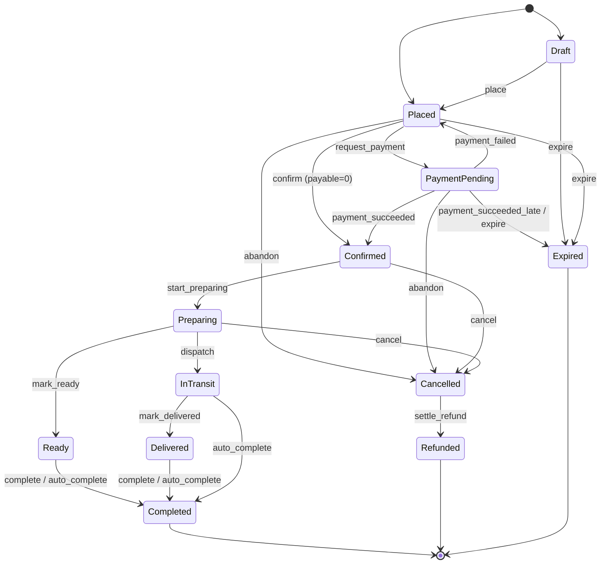

> ← Back to [PRD: Pre-Order Core Module — Index](../prd.md)

# 3.3 Order Lifecycle State Machine

Every order status change goes through **one** explicit transition table. Anything not in the table is illegal.

## States

| State | Terminal | Meaning |
|---|---|---|
| `Draft` | no | Server-side cart with active holds (optional; carts may live client-side and skip straight to `Placed`). |
| `Placed` | no | Customer submitted; lines priced and snapshotted; holds active. |
| `PaymentPending` | no | A payment intent exists for the payable remainder; awaiting provider confirmation. |
| `Confirmed` | no | Paid (or fully covered by credits / zero-priced); holds **committed**. |
| `Preparing` | no | Production started. Customer self-cancel is normally blocked from here by policy. |
| `Ready` | no | Ready for pickup (mode `pickup`). |
| `InTransit` | no | Handed to courier (mode `delivery`). |
| `Delivered` | no | Delivery confirmed; awaiting completion (dispute window). |
| `Completed` | **yes** | Fulfilment closed. |
| `Cancelled` | no* | Cancelled by customer, merchant, or system; refund disposition pending. |
| `Refunded` | **yes** | Cancellation financially settled (credit issued and/or provider refund succeeded). |
| `Expired` | **yes** | Never confirmed (draft/payment TTL or post-cutoff confirmation). Holds released. |

\* `Cancelled` is final when the refundable amount is zero; otherwise it moves to `Refunded` via T17 once the refund disposition is executed.

## Transition Table (normative)

| # | From | Action | To | Actor(s) | Guards | Side effects (same unit of work) |
|---|---|---|---|---|---|---|
| T1 | — | `create_draft` | `Draft` | customer | window open; eligible | reserve holds ([3.4](./04-inventory-holds-reservations.md)) |
| T2 | `Draft` / — | `place` | `Placed` | customer | window open; eligible; every line has an active hold; `PricingRule` evaluated | snapshot prices; compute `creditApplied`, `payableMinor` |
| T3 | `Placed` | `request_payment` | `PaymentPending` | system | `payableMinor > 0` | create `PaymentIntent` ([3.7](./07-payment-hooks-intent-webhooks-reconciliation.md)); extend holds to payment TTL |
| T4 | `Placed` | `confirm` | `Confirmed` | system | `payableMinor == 0` | debit credits; commit holds |
| T5 | `PaymentPending` | `payment_succeeded` | `Confirmed` | system (webhook) | intent `Succeeded`; `now < cutoffAt + cutoffGrace` | debit credits; commit holds |
| T6 | `PaymentPending` | `payment_succeeded_late` | `Expired` | system | intent `Succeeded`; `now ≥ cutoffAt + cutoffGrace` **or** holds already expired and capacity gone | release holds; issue provider refund or credit per config |
| T7 | `PaymentPending` | `payment_failed` | `Placed` | system | intent `Failed`; holds still active | — (customer may retry → T3) |
| T8 | `Draft`, `Placed`, `PaymentPending` | `expire` | `Expired` | system (scheduler) | hold/payment TTL elapsed | release holds; void intent |
| T9 | `Placed`, `PaymentPending` | `abandon` | `Cancelled` | customer | — | release holds; void intent |
| T10 | `Confirmed`, `Preparing` | `cancel` | `Cancelled` | customer, owner, operator, system | `CancellationPolicy.evaluate()` allows for this actor | release committed units (if before production lock); create `CancellationDecision` ([3.5](./05-cancellations-policies.md)) |
| T11 | `Confirmed` | `start_preparing` | `Preparing` | operator, owner | slot not cancelled | — |
| T12 | `Preparing` | `mark_ready` | `Ready` | operator, owner | order mode `pickup` | notify |
| T13 | `Preparing` | `dispatch` | `InTransit` | operator, owner | order mode `delivery` | store dispatch metadata `{ partner?, trackingRef? }` |
| T14 | `InTransit` | `mark_delivered` | `Delivered` | operator, owner, system | — | notify |
| T15 | `Ready`, `Delivered` | `complete` | `Completed` | operator, owner, customer (handover confirm) | — | — |
| T16 | `Ready`, `InTransit`, `Delivered` | `auto_complete` | `Completed` | system (scheduler) | `now ≥ stateEnteredAt + autoCompleteAfter` (per-state config) | — |
| T17 | `Cancelled` | `settle_refund` | `Refunded` | system | refund disposition fully executed | ledger credit and/or provider refund recorded |
| T18 | any non-terminal | `acknowledge` | *(same)* | operator, owner | — | sets `acknowledgedAt`, `acknowledgedBy`; does **not** change state |

**Optimistic concurrency**: every transition requires the caller's expected `version`; the update is `UPDATE … SET state=?, version=version+1 WHERE id=? AND version=? AND state=?`. Zero rows ⇒ `409 ILLEGAL_TRANSITION` (state changed) or `412 VERSION_CONFLICT`.



## User Stories

* **US-PM-09**: As a `customer`, I want to place one or more orders (possibly for different slots) and pay once via a **checkout group**, so that I am not charged multiple times for one shopping session.
  * **Given** a cart with lines for slots `S1` and `S2`, **When** I place it, **Then** two orders are created in `Placed`, linked to one `CheckoutGroup`, and one payment intent covers the sum of their `payableMinor`.
  * **Given** the intent succeeds, **When** the webhook is processed, **Then** both orders transition T5 atomically; if one order's guard fails (late), it alone takes T6 and the other confirms.
* **US-PM-10**: As an `operator`, I want to advance an order only through legal next states and see the allowed actions per order, so that I can't make mistakes on a busy board.
  * **Given** an order in `Confirmed`, **When** I request `GET /v1/orders/{id}`, **Then** `allowedActions` for role `operator` is `["start_preparing","cancel","acknowledge"]` (cancel only if policy allows).
  * **Given** an order in `Preparing` with mode `pickup`, **When** I call `dispatch`, **Then** `409 ILLEGAL_TRANSITION` with `details.allowed=["mark_ready","cancel","acknowledge"]`.
* **US-PM-11**: As an `owner`, I want every transition recorded with actor, timestamp, from/to and reason, so that I can audit disputes.
  * **Given** any successful transition, **Then** an `order_transition` row and a domain event are written in the same transaction as the state change.
* **US-PM-12**: As an `owner`, I want stale orders auto-completed after configurable durations (e.g. `InTransit` → `Completed` after 24 h), so that the board stays clean.
  * **Given** `autoCompleteAfter.InTransit = PT24H` and an order entered `InTransit` 25 h ago, **When** the job runs, **Then** T16 fires with `actor=system, reason="auto_complete"`.

## Data Model

| Entity | Key fields |
|---|---|
| `CheckoutGroup` | `id`, `accountId`, `customerId`, `totalMinor`, `creditAppliedMinor`, `payableMinor`, `currency`, `paymentIntentId?`, `createdAt` |
| `Order` | `id`, `checkoutGroupId`, `customerId`, `accountId?`, `slotId`, `locationId`, `mode: pickup\|delivery`, `state`, `stateEnteredAt`, `version`, `subtotalMinor`, `adjustmentsMinor`, `creditAppliedMinor`, `payableMinor`, `currency`, `deliveryPoint?: { lat, lng, label, instructions }`, `recipient?: { name, phone }`, `notes?`, `acknowledgedAt?`, `acknowledgedBy?`, `dispatch?: JSON`, `metadata: JSON`, `createdAt`, `updatedAt` |
| `OrderLine` | `id`, `orderId`, `offeringId`, `itemId`, `nameSnapshot`, `unitPriceMinor`, `quantity`, `lineTotalMinor`, `holdId` |
| `OrderTransition` | `id`, `orderId`, `fromState`, `toState`, `action`, `actorRole`, `actorId?`, `reason?`, `at`, `version` |

### Suggested SQL
```sql
CREATE TABLE checkout_group (
  id TEXT PRIMARY KEY, account_id TEXT, customer_id TEXT NOT NULL,
  total_minor INTEGER NOT NULL, credit_applied_minor INTEGER NOT NULL DEFAULT 0,
  payable_minor INTEGER NOT NULL, currency TEXT NOT NULL,
  payment_intent_id TEXT, created_at TIMESTAMPTZ NOT NULL DEFAULT now()
);
CREATE TABLE "order" (                        -- D1: name it orders
  id TEXT PRIMARY KEY,
  checkout_group_id TEXT NOT NULL REFERENCES checkout_group(id),
  customer_id TEXT NOT NULL, account_id TEXT,
  slot_id TEXT NOT NULL REFERENCES slot(id),
  location_id TEXT NOT NULL REFERENCES fulfilment_location(id),
  mode TEXT NOT NULL CHECK (mode IN ('pickup','delivery')),
  state TEXT NOT NULL CHECK (state IN ('Draft','Placed','PaymentPending','Confirmed','Preparing','Ready','InTransit','Delivered','Completed','Cancelled','Refunded','Expired')),
  state_entered_at TIMESTAMPTZ NOT NULL,
  version INTEGER NOT NULL DEFAULT 1,
  subtotal_minor INTEGER NOT NULL, adjustments_minor INTEGER NOT NULL DEFAULT 0,
  credit_applied_minor INTEGER NOT NULL DEFAULT 0, payable_minor INTEGER NOT NULL,
  currency TEXT NOT NULL,
  delivery_point JSONB, recipient JSONB, notes TEXT,
  acknowledged_at TIMESTAMPTZ, acknowledged_by TEXT,
  dispatch JSONB, metadata JSONB NOT NULL DEFAULT '{}',
  created_at TIMESTAMPTZ NOT NULL DEFAULT now(), updated_at TIMESTAMPTZ NOT NULL DEFAULT now()
);
CREATE INDEX order_slot_state_idx ON "order" (slot_id, state);
CREATE INDEX order_customer_idx ON "order" (customer_id, created_at DESC);
CREATE INDEX order_state_entered_idx ON "order" (state, state_entered_at); -- scheduler scans
CREATE TABLE order_line (
  id TEXT PRIMARY KEY, order_id TEXT NOT NULL REFERENCES "order"(id),
  offering_id TEXT NOT NULL REFERENCES offering(id), item_id TEXT NOT NULL,
  name_snapshot TEXT NOT NULL, unit_price_minor INTEGER NOT NULL,
  quantity INTEGER NOT NULL CHECK (quantity > 0), line_total_minor INTEGER NOT NULL,
  hold_id TEXT NOT NULL
);
CREATE TABLE order_transition (
  id TEXT PRIMARY KEY, order_id TEXT NOT NULL REFERENCES "order"(id),
  from_state TEXT, to_state TEXT NOT NULL, action TEXT NOT NULL,
  actor_role TEXT NOT NULL, actor_id TEXT, reason TEXT,
  at TIMESTAMPTZ NOT NULL, version INTEGER NOT NULL
);
```

## API Contract

| Method & Path | Role(s) | Request | Response | Errors |
|---|---|---|---|---|
| `POST /v1/checkouts` | customer | `Idempotency-Key`; `{ accountId?, applyCredits: boolean, orders: [{ slotId, mode, deliveryPoint?, recipient?, notes?, lines: [{ offeringId, quantity, holdId? }] }] }` | `201 { checkoutGroup, orders: Order[], payment?: { intentId, clientSecret?, redirectUrl?, expiresAt } }` | `409 WINDOW_CLOSED`, `409 WINDOW_NOT_OPEN`, `409 INSUFFICIENT_CAPACITY`, `422 NOT_ELIGIBLE`, `422 MAX_PER_ORDER_EXCEEDED`, `409 IDEMPOTENCY_KEY_REUSED` |
| `GET /v1/orders/{id}` | customer (own), operator (scoped), owner | — | `200 Order & { lines, allowedActions: string[], transitions? }` + `ETag` | `404 ORDER_NOT_FOUND` |
| `GET /v1/orders?slotId=&state=&locationId=&cursor=` | operator (scoped), owner | — | `200 { items: OrderSummary[], nextCursor? }` | — |
| `GET /v1/me/orders?cursor=` | customer | — | `200 { items: OrderSummary[], nextCursor? }` | — |
| `POST /v1/orders/{id}:transition` | per table | `If-Match: "<version>"`, `Idempotency-Key`; `{ action, reason?, dispatch? }` | `200 Order` | `409 ILLEGAL_TRANSITION { allowed[] }`, `412 VERSION_CONFLICT`, `403 ACTION_NOT_PERMITTED`, `409 POLICY_DENIED` |

`Order` JSON schema (abridged):
```json
{
  "type": "object",
  "required": ["id","state","version","slotId","mode","currency","subtotalMinor","payableMinor","updatedAt"],
  "properties": {
    "id": {"type":"string"}, "checkoutGroupId": {"type":"string"},
    "state": {"enum":["Draft","Placed","PaymentPending","Confirmed","Preparing","Ready","InTransit","Delivered","Completed","Cancelled","Refunded","Expired"]},
    "version": {"type":"integer","minimum":1},
    "slotId": {"type":"string"}, "mode": {"enum":["pickup","delivery"]},
    "subtotalMinor": {"type":"integer"}, "creditAppliedMinor": {"type":"integer"}, "payableMinor": {"type":"integer"},
    "currency": {"type":"string","pattern":"^[A-Z]{3}$"},
    "acknowledgedAt": {"type":["string","null"],"format":"date-time"},
    "allowedActions": {"type":"array","items":{"type":"string"}},
    "updatedAt": {"type":"string","format":"date-time"}
  }
}
```

## Domain Events
`OrderDrafted`, `OrderPlaced`, `OrderPaymentRequested`, `OrderConfirmed`, `OrderPaymentFailed`, `OrderExpired { reason }`, `OrderCancelled { actorRole, policyId, decisionId }`, `OrderPreparationStarted`, `OrderReady`, `OrderDispatched`, `OrderDelivered`, `OrderCompleted { auto: boolean }`, `OrderRefunded { amountMinor, disposition }`, `OrderAcknowledged`. Each carries `aggregateVersion` = the order's new `version`.

## Invariants
* `state` changes only via a row in the transition table; each change increments `version` by exactly 1 and writes one `order_transition`.
* `Confirmed` ⇒ every line's hold is `Committed`. `Expired`/`Cancelled` ⇒ no line has an `Active` hold.
* `payableMinor = max(0, subtotalMinor + adjustmentsMinor − creditAppliedMinor)`.
* Terminal states accept no actions except reads.
* Line prices never change after `Placed`.

## Codegen Notes
* **Module**: `core/order` — pure `transition(order, action, ctx) → { order, events, effects } | Rejection`. Effects (`ReserveHolds`, `CommitHolds`, `ReleaseHolds`, `CreatePaymentIntent`, `DebitCredits`, `EvaluateCancellation`, `Notify`) are data, executed by an application service inside `UnitOfWork`.
* **Types**:
  ```ts
  type OrderState = 'Draft'|'Placed'|'PaymentPending'|'Confirmed'|'Preparing'|'Ready'|'InTransit'|'Delivered'|'Completed'|'Cancelled'|'Refunded'|'Expired';
  type OrderAction = 'create_draft'|'place'|'request_payment'|'confirm'|'payment_succeeded'|'payment_succeeded_late'|'payment_failed'|'expire'|'abandon'|'cancel'|'start_preparing'|'mark_ready'|'dispatch'|'mark_delivered'|'complete'|'auto_complete'|'settle_refund'|'acknowledge';
  type ActorRole = 'owner'|'operator'|'customer'|'system';
  interface TransitionRule { id: string; from: OrderState[]; action: OrderAction; to: OrderState | 'same'; actors: ActorRole[]; guards: Guard[]; effects: EffectKind[] }
  export const TRANSITIONS: readonly TransitionRule[]; // generated 1:1 from the table above
  function allowedActions(order: Order, role: ActorRole, ctx: GuardContext): OrderAction[];
  ```
* **Tests to generate**: table-driven test for every row (legal) and the full cartesian product of `state × action` (illegal ⇒ rejection, no effects); version conflict; checkout group partial late-confirmation; `allowedActions` per role; auto-complete thresholds; terminal immutability; property test: random legal action sequences never violate invariants.
